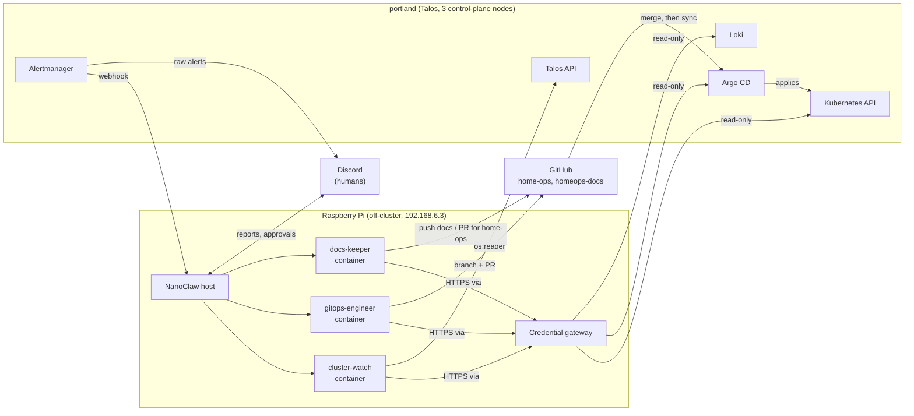
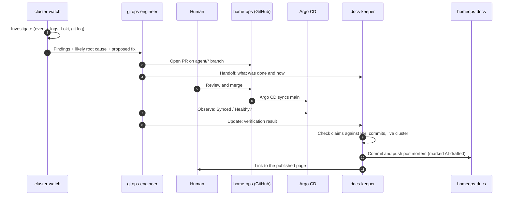
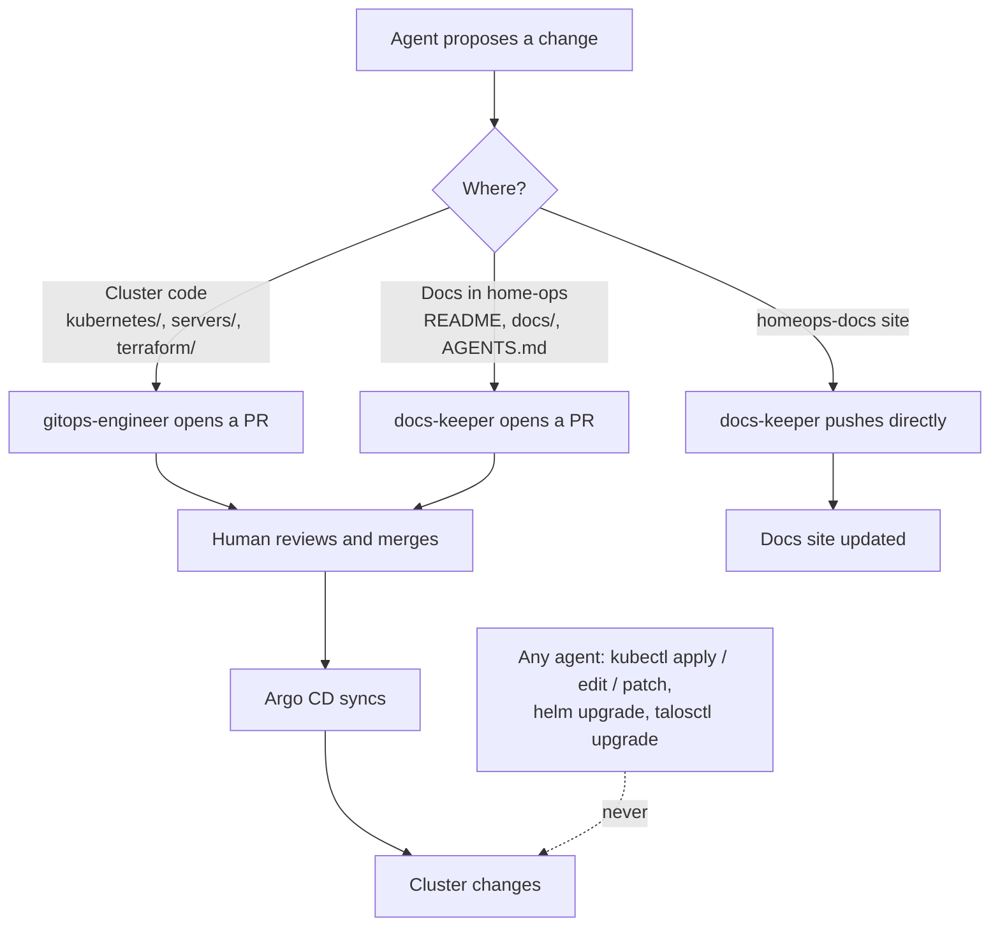
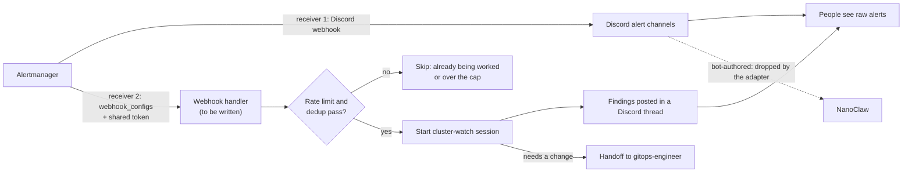
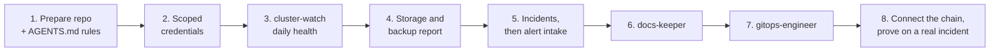

<p align="center">
  
</p>

<h1 align="center">NanoClaw Home AIOps</h1>

<p align="center">
  A fork of <a href="https://github.com/nanocoai/nanoclaw">NanoClaw</a> that runs AI agents to look after my home Talos Kubernetes cluster, <code>portland</code>.
</p>

## What this is

NanoClaw runs each agent in its own Linux container, with only the mounts, tools and credentials it has been given. This fork uses that to run a small team of **read-only operations agents** for a home-lab cluster:

- **Cluster:** `portland`, three Dell OptiPlex nodes running Talos Linux and Kubernetes. All three are control planes that also run workloads.
- **GitOps:** Argo CD deploys everything from [`mrpbennett/home-ops`](https://github.com/mrpbennett/home-ops) using ApplicationSets. **Git is the only way a change reaches the cluster**, so agents propose changes as pull requests and a human merges them.
- **Docs:** incidents are written up as postmortems on the [`mrpbennett/homeops-docs`](https://github.com/mrpbennett/homeops-docs) site.
- **Tools the agents use:** `kubectl`, `talosctl`, `argocd`, `git`/`gh`, `helm`, `yq`, `kubeconform` and `logcli` (Loki).

The agents run **off-cluster**, on a Raspberry Pi (arm64, Docker). An outage of the cluster therefore cannot take down the agents that would report it, and they use none of the cluster's scarce memory. They report back through **Discord**.

### Where everything runs



The full build spec and decision record is `notes/nanoclaw-agents.md` in the home-operations workspace. This README is the short version. Where they differ, the notes are the source of truth.

## The agents

Six jobs, grouped into three agents so that credentials stay narrow. Only one agent can touch `home-ops` through git, and none can write to the cluster.

| Agent | Jobs | Cluster access | Git access | Schedule |
| ----- | ---- | -------------- | ---------- | -------- |
| `cluster-watch` | Daily health checks, incident investigation, storage and backup oversight | Read-only | None | Daily (health), weekly (storage and backups), on request or from an alert (incidents) |
| `gitops-engineer` | Fix PRs, update planning | Read-only | Branch and PR on `home-ops` | On request, weekly (updates) |
| `docs-keeper` | Documentation, postmortems | Read-only | Push to `homeops-docs`. Branch and PR for anything in `home-ops` | On handoff, after merges, weekly drift check |

### The handoff chain

Every incident follows the same path. Agents pass short written documents to each other, never credentials.



An agent-found, agent-fixed incident ends as a postmortem on the docs site, without anyone copying text between tools. Incidents that need no change (a transient blip, a self-healed alert) skip `gitops-engineer` and go to `docs-keeper` as a short note.

### Who can change what



### Principles

1. **Read-only by default.** Anything that changes the cluster goes through a git PR that a human merges.
2. **Portland only.** Every `kubectl`, `helm` and `argocd` call passes `--context portland`, and the agent's kubeconfig contains only that context.
3. **Evidence is separate from guesses.** Reports label what was observed (output, logs, SHAs) and what is inferred.
4. **No secrets in output.** Agents never print Secret data, Vault values, tokens or Terraform state.
5. **Smallest safe change.** A values tweak or a revert beats a redesign.
6. **No unattended disruption.** No node reboots, drains, Talos upgrades or Kubernetes upgrades without a human.

## Access model

| Tool | How access is limited |
| ---- | --------------------- |
| `kubectl` | A dedicated ServiceAccount bound to a read-only ClusterRole (`get/list/watch` plus `pods/log`), **excluding `secrets`**. Delivered as a kubeconfig with only the `portland` context. |
| `argocd` | A project-scoped API token with `get` on applications only. No `sync`, `override` or `delete`. |
| `talosctl` | A client config generated with `--roles os:reader`. The admin `talosconfig` and `secrets.yaml` are never mounted. |
| `logcli` | Points at the Loki gateway, read-only. |
| `git` / `gh` | Two separate credentials. For `home-ops`: push branches and open PRs only, with branch protection on `main` so the token cannot merge. For `homeops-docs`: a token held by `docs-keeper` only. |
| Vault | No access. |

Credentials never enter the container. The credential gateway injects them into outbound requests. See [docs/gateway-seam.md](docs/gateway-seam.md).

Agent workspaces mount **dedicated clones** of each repo, not the live checkouts, because the live `home-ops` directory holds gitignored secrets (`secrets.yaml`, `talosconfig`, `terraform.tfvars`). Clones are read-only for `cluster-watch` and read-write only for `gitops-engineer` and `docs-keeper`.

## Alert intake

Alertmanager already posts to Discord for people. The NanoClaw Discord adapter ignores messages written by bots, so agents cannot read those posts. Instead, Alertmanager will also send alerts to a webhook handler on the Pi, which starts a `cluster-watch` session. That agent investigates and posts its findings in a thread. The handler needs a shared token, rate limiting and dedup before it is enabled.



Not yet confirmed: that bot posts are really dropped (test with `ncl dropped-messages list`), and that pods can reach the Pi on the webhook port.

## Status

This fork is being built in stages. The rollout order is:

1. Prepare the `home-ops` repo and settle the `AGENTS.md` rules for agent commits.
2. Create the scoped credentials (kubeconfig, Argo CD token, Talos reader config, git tokens).
3. `cluster-watch` daily health checks.
4. Storage and backup reporting.
5. Incident investigation, then alert intake.
6. `docs-keeper`.
7. `gitops-engineer`.
8. Connect the handoff chain and prove it on one real incident.



Progress and decisions are recorded in the notes file.

## Running it

This is a standard NanoClaw v2 install. Setup, the Discord channel and the credential gateway are installed with the upstream skills.

```bash
bash nanoclaw.sh            # first-time setup
pnpm run build              # compile the host
./container/build.sh        # rebuild the agent image (adds the cluster CLIs)
systemctl --user restart nanoclaw
```

Agent groups, wirings and scheduled tasks are managed with the `ncl` CLI (`ncl groups`, `ncl wirings`, `ncl tasks`). See [CLAUDE.md](CLAUDE.md) for the architecture overview and the [docs](docs/) folder for detail.

## Upstream

This fork tracks [nanocoai/nanoclaw](https://github.com/nanocoai/nanoclaw). Fork-specific changes are kept small so upstream updates stay easy to take with `/update-nanoclaw`. See [CHANGELOG.md](CHANGELOG.md) for breaking changes, or the [full release history](https://docs.nanoclaw.dev/changelog).

## License

MIT
